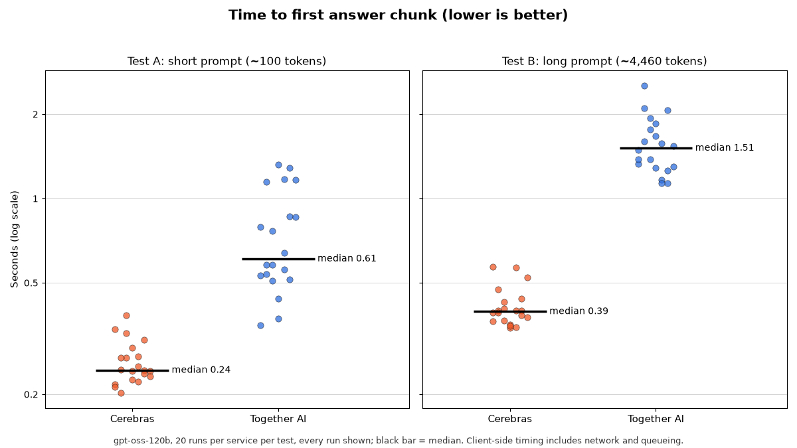
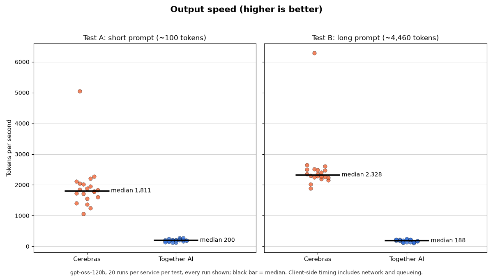
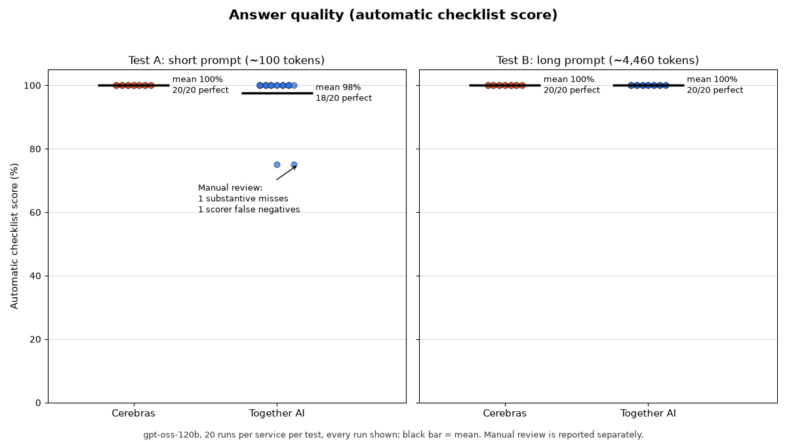

# Same Model, Two Inference Services: Cerebras vs. Together AI

A small, reproducible benchmark of `gpt-oss-120b` served by two providers, each called directly through its own OpenAI-compatible API:

- **Cerebras Inference API** (`gpt-oss-120b`)
- **Together AI** (`openai/gpt-oss-120b`)

This compares **services**, not chips. All times are measured on the client and include network latency, queueing, and serving software.

Article: [Advisee AI on Substack](https://advisee.substack.com/)

## Results (October 24, 2026)

20 measured runs per service per test. Medians, with the full-run range in brackets.

| Test | Service | First answer chunk (s) | Output speed (tok/s) | Delayed >10 s | Perfect quality score |
|---|---|---|---|---|---|
| A: short prompt (~100 tokens) | Cerebras | 0.25 [0.19–58.59] | 1,811 [1,056–5,051] | 4/20 | 20/20 |
| A: short prompt (~100 tokens) | Together AI | 0.72 [0.34–1.24] | 200 [130–267] | 0/20 | 16/20 |
| B: long prompt (~4,460 tokens) | Cerebras | 0.36 [0.32–53.56] | 2,328 [1,884–6,286] | 1/20 | 20/20 |
| B: long prompt (~4,460 tokens) | Together AI | 1.37 [1.13–2.42] | 188 [117–249] | 0/20 | 20/20 |

All 80 measured requests succeeded, with no errors, truncations, or empty answers.







### Notable findings

- **Delayed first chunk.** Five of 40 Cerebras requests experienced an approximately 50–58 second delay before the first streamed text arrived. The requests then generated at normal speed. This may indicate provider-side queueing or scheduling, but the cause cannot be confirmed from client-side measurements. No rate-limit errors occurred, which does not rule out queueing. Median throughput does not fully describe end-to-end reliability or user experience.
- **Reaction to the run ID.** Each prompt starts with a unique `[run <id>]` prefix to reduce prefix-cache reuse. In 3 of 20 short-prompt runs, Together's responses treated it as a command ("I can't run that command") and omitted the vapor-pressure explanation. Cerebras never did this. Together therefore had 3 substantive short-task misses plus 1 scorer false negative (a correct answer the keyword scorer missed).
- **Caching.** Cerebras reported 0 cached prompt tokens. Together reported 66–69 cached tokens on every request, consistent with the fixed chat-template text that comes before the unique run ID.

## Method

| Setting | Value (identical on both services) |
|---|---|
| `temperature` | 1.0 |
| `max_tokens` | 2048 |
| `reasoning_effort` | `medium` |
| Streaming | on, with `stream_options={"include_usage": True}` |

- **Pairs.** Each pair is one Cerebras and one Together request with the same run ID and identical prompt. Service order alternates between pairs, short and long pairs alternate, and requests run one at a time with a 2-second pause.
- **Warm-up.** One request per service per test, stored but excluded from statistics.
- **Token counts.** As reported by each API's usage object, never estimated.
- **Time to first answer chunk.** Request start until the first chunk with visible answer text. Chunks can hold several tokens, so this is "first text chunk," not "first token."
- **Output speed.** Completion tokens ÷ (total response time − time to first reasoning chunk). It uses the whole stream, so chunk size does not distort it. Per-phase reasoning and answer speeds are in the raw data as exploratory only: Cerebras sends 13–30 large chunks per response (Together: 66–303), so its per-phase windows are too short to be reliable.
- **Quality.** Each answer is scored against a checklist written before testing (`prompts/*_checklist.json`) by keyword matching (`score.py`), then spot-checked by hand (`results/manual_review.json`).
- **p95** values in `results/summary.csv` are exploratory; with 20 runs they depend on the slowest one or two requests.

### Prompts

- **Test A:** "In two or three sentences, explain why the boiling point of water is lower at high altitude than at sea level."
- **Test B:** an excerpt of about 3,600 words from the *Report of the Presidential Commission on the Space Shuttle Challenger Accident* (1986), Chapter IV, followed by 3 factual questions. Public domain; see `prompts/long_source.md`.

## Limitations

- Two workloads, one model, one client location, one test date.
- Measures services, not chips: network, queueing, and serving software are all included.
- 20 runs per service per test is a small sample.
- Prompt caching cannot be fully controlled; it is recorded as each API reports it.
- Requests are sequential; no concurrency or load testing.
- Prices are each provider's published rates on the test date.

## Reproduce

Requires Python 3.10 or newer and API keys for both services.

```powershell
python -m venv .venv
.\.venv\Scripts\Activate.ps1
pip install openai pandas matplotlib python-dotenv
```

Create `.env` in the project root:

```
CEREBRAS_API_KEY=your_cerebras_key
TOGETHER_API_KEY=your_together_key
```

Then run each phase:

```powershell
python pilot_benchmark.py   # 3 short pairs + 1 long pair, checks API fields
python estimate_cost.py     # budget estimate from pilot token counts
python benchmark.py         # 4 warm-ups + 80 measured requests (move results/benchmark_results.jsonl aside first)
python score.py             # scored copy + spot-check sheet
python analyze.py           # summary.csv, markdown table, charts
```

The full benchmark cost about $0.06 at the prices in `estimate_cost.py`.

## Files

| Path | Contents |
|---|---|
| `pilot_benchmark.py` | Pilot run and the shared request and timing code |
| `estimate_cost.py` | Budget estimate and per-million-token prices |
| `benchmark.py` | Full benchmark |
| `score.py` | Checklist scoring |
| `analyze.py` | Statistics, summary table, charts |
| `prompts/` | Prompts, checklists, long-prompt source |
| `results/` | Raw results, scored copy, manual review, summary |
| `charts/` | Chart PNGs |
| `TDD_Inference_Benchmark.md` | Technical design document |
